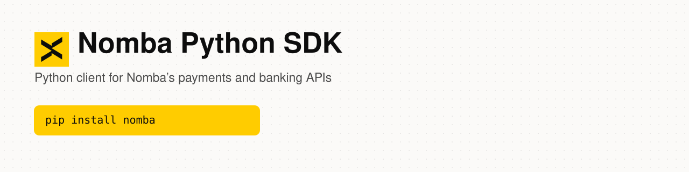

<picture>
  <source media="(prefers-color-scheme: dark)" srcset="https://raw.githubusercontent.com/NombaOSS/nomba-python-sdk/main/.github/assets/banner-dark.svg">
  
</picture>

# Nomba Python SDK

A Python client for [Nomba's](https://nomba.com) payments and banking APIs: checkout, transfers, virtual accounts, direct debits, terminals, electricity, cable TV, betting, airtime and data, cross-border payouts and collections, webhooks, and account/transaction lookups.

[](https://github.com/NombaOSS/nomba-python-sdk/actions/workflows/ci.yml)

> **Status:** this is a port of the [Node SDK](https://github.com/NombaOSS/nomba-node-sdk) onto Nomba's published API docs. It has not yet been verified against the live sandbox API — treat response shapes and edge-case behavior as best-effort until that verification happens.

Typed params and responses (`TypedDict`s and dataclasses), a settle-into-one-outcome pattern for money-moving calls, automatic token handling, and webhook verification. Python 3.12 or newer. The only dependency is [httpx](https://www.python-httpx.org/).

## Install

```bash
pip install nomba
```

## Quickstart

```python
import os
from nomba import Nomba

client = Nomba(
    client_id=os.environ["NOMBA_CLIENT_ID"],
    client_secret=os.environ["NOMBA_CLIENT_SECRET"],
    account_id=os.environ["NOMBA_ACCOUNT_ID"],
    environment="sandbox",  # "production" (default) or "sandbox"
)

order = client.checkout.create_order(
    {
        "orderReference": "order-1234",
        "customerEmail": "customer@example.com",
        "amount": 5000,
        "currency": "NGN",
        "callbackUrl": "https://example.com/callback",
    }
)
print(order.checkoutLink)  # send the customer here to pay
```

The SDK issues an access token on first use and refreshes it automatically before it expires — no manual token handling required.

## Configuration

| Option | Default | Notes |
|---|---|---|
| `client_id` | — | Required. |
| `client_secret` | — | Required. |
| `account_id` | — | Required. Parent account ID of the business. |
| `environment` | `"production"` | `"production"` or `"sandbox"`. Sandbox and production credentials are not interchangeable. |
| `token_store` | in-memory, single process | See [Token handling](#token-handling). |
| `http_client` | a new transport | Mainly for tests; injects a custom `HttpClient`. |

## Resources

Every resource hangs off the client (`client.<resource>`), and every method maps to one documented Nomba endpoint. Body parameters are `TypedDict`s with Nomba's field names; responses are typed dataclasses.

### Accounts

```python
account = client.accounts.get_parent_account()
print(account.accountName, account.currency)

for terminal in client.accounts.iterate_parent_terminals():
    print(terminal.terminalId)
```

### Transfers

```python
from nomba import NombaError, UnconfirmedOutcomeError

banks = client.transfers.list_banks()

result = client.transfers.bank_transfer(
    "payout-9981",  # merchant_tx_ref: your own reference, the idempotency key
    amount=1000,
    accountNumber="0123456789",
    accountName="Jane Doe",
    bankCode=banks[0].code,
    on_success=lambda data: print("sent:", data),
    on_pending=lambda data: print("still processing, requery later:", data),
    on_failed=lambda err: print("failed:", err),
)
```

Every money-moving method (bank transfers, wallet transfers, bill payments, airtime/data purchases, mandate debits...) takes `on_success`/`on_pending`/`on_failed` callbacks. Without them, success returns the response data, a pending/undocumented outcome raises `UnconfirmedOutcomeError`, and a failure raises `NombaError`. Reuse the same `merchant_tx_ref` when checking on a pending transfer — never generate a new one to retry it.

### Virtual accounts, checkout, charge, terminals, direct debits

```python
client.virtual_accounts.create(**{...})
client.checkout.create_order({...})  # order dict is positional
client.charge.submit_card_details(**{...})
client.terminals.assign_to_parent(**{...})
client.direct_debits.create_mandate(**{...})
```

### Bills (version 1 lookups) and bill payments (version 2)

```python
providers = client.bill_electricity.get_electricity_providers()
plans = client.bill_data.get_data_plans("mtn")

client.electricity.pay_electricity("bill-5521", **{...})
client.data.buy_data("bill-5522", **{...})
client.airtime.buy_airtime("bill-5523", **{...})
```

### Transactions and requery

```python
page = client.transactions.list_parent_transactions(limit=50)
client.requery.requery_by_session(session_id)
```

### Global payouts and collections

```python
client.payouts.exchange_rates(**{"from": "USD", "to": "CDF"})
client.collections.initiate_inflow(**{...})
```

### Webhooks

```python
from nomba import verify_signature

is_valid = verify_signature(
    body=request.body,  # raw request body (str or bytes)
    signature=request.headers["nomba-signature"],
    timestamp=request.headers["nomba-timestamp"],
    secret=os.environ["NOMBA_WEBHOOK_SECRET"],
)
```

`verify_signature` never raises — a missing or malformed signature or body returns `False`.

| Resource | Covers |
|---|---|
| `client.accounts` | Parent and sub-account details, balances, assigned terminals |
| `client.virtual_accounts` | Create, update, expire, look up and list virtual accounts |
| `client.checkout` | Hosted checkout orders, refunds, tokenized cards |
| `client.charge` | Custom card payment flow: card details, OTP, saved cards |
| `client.transfers` | Bank list, account lookup, bank and wallet transfers |
| `client.direct_debits` | Direct debit mandates: create, debit, list, suspend/reactivate |
| `client.terminals` | Assign/unassign POS terminals, push payment requests |
| `client.transactions` | List and filter transactions on parent, sub and virtual accounts |
| `client.requery` | Look up one transaction's current status |
| `client.bill_electricity` / `.bill_cable` / `.bill_betting` / `.bill_data` | Bill lookups (version 1): provider lists, plans, customer lookup |
| `client.electricity` / `.cable` / `.betting` | Bill payments (version 2) |
| `client.airtime` / `.data` | Airtime and data bundle purchases (version 2) |
| `client.collections` | DRC mobile money inflows |
| `client.payouts` | Currency wallets, exchange rates, cross-border transfers |
| `client.webhooks` | Webhook delivery logs, subscriptions, re-push/bulk re-push, replay |
| `nomba.verify_signature` | Check a webhook's signature |

## Outcome handling

The SDK never guesses on a money-moving call. Every outcome settles into exactly one of three states, using only the codes and statuses Nomba's docs list for that endpoint:

| Outcome | Meaning | Default behavior without a callback |
|---|---|---|
| `success` | A documented success code/status. Safe to fulfil the order. | Returns the response data. |
| `pending` | Final status unknown, or an undocumented code/status came back. Wait for the webhook or requery. | Raises `UnconfirmedOutcomeError` (or `OutcomeUnknownError` on a transport failure). |
| `failed` | A documented rejection. Safe to tell the customer it failed. | Raises `NombaError`. |

Pass `on_success` / `on_pending` / `on_failed` to handle each case explicitly instead of catching exceptions.

Every money-moving call requires a caller-supplied idempotency key (`merchant_tx_ref` or equivalent) — the SDK never generates one, to avoid ever double-disbursing funds. Omitting it raises `IdempotencyKeyAbsentError`. Reuse the same key when requerying or retrying a pending call; never mint a new one.

## Errors

| Exception | Subclass of `NombaError`? | When |
|---|---|---|
| `NombaError` | — | Any non-2xx response, or a 2xx whose body code is not one the call accepts. |
| `UnconfirmedOutcomeError` | No | A money-moving call got a readable answer whose body code or status is undocumented. May still complete. |
| `OutcomeUnknownError` | No | A money-moving call failed in a way that doesn't say whether it was processed (timeout, network error, 5xx, 409). |
| `TokenError` | No | Getting or renewing the access token failed; the request was never sent. |
| `IdempotencyKeyAbsentError` | No | A money-moving request was attempted without a caller-supplied idempotency key. |

`OutcomeUnknownError`, `UnconfirmedOutcomeError`, `TokenError` and `IdempotencyKeyAbsentError` are deliberately **not** subclasses of `NombaError`, so `except NombaError` can never treat a payment that may have gone through as failed. Use `nomba.lib.errors.is_pending(err)` to check for either pending case.

## Token handling

The client gets an access token on first use, refreshes it automatically before it expires, and shares one in-flight token request between concurrent calls. Tokens live in memory by default.

```python
from nomba import Nomba
from nomba.lib.token_store import TokenStore

client = Nomba(..., token_store=my_token_store)  # implements TokenStore
```

## Pagination

Paginated list methods have an `iterate_*` counterpart that lazily walks every page for you:

```python
for terminal in client.accounts.iterate_parent_terminals():
    print(terminal.terminalId)
```

## Development

```bash
uv sync               # install the package and dev tools
uv run ruff check .   # lint
uv run ruff format .  # format
uv run mypy           # type-check (strict)
uv run pytest         # tests
```

See [CONTRIBUTING.md](CONTRIBUTING.md) for the full contribution guide (Nomba-docs-first, tests required, Conventional Commits).

## Links

- [Nomba API documentation](https://developer.nomba.com)
- [Contributing guide](CONTRIBUTING.md), [Security policy](SECURITY.md), [Releasing](RELEASING.md)
- [Changelog](CHANGELOG.md)

## License

[MIT](LICENSE)
